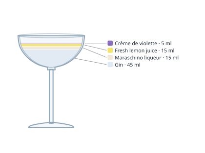

# Bartender

Interactive cocktail recipes with glass diagrams, starting from the 90 cocktails on the
[IBA official list](https://iba-world.com/cocktails/all-cocktails/). The same data and
maths power a web app, a REST API and an MCP server, so bars, people and AI assistants
can all use the recipes.

Try the Aviation: run the app and open `/cocktails/aviation`.



## What is in the box

| Package | Purpose |
| --- | --- |
| `packages/core` | Platform-agnostic TypeScript library: recipe schema (zod), the IBA recipes, the glassware catalogue, unit conversion and the level-diagram maths plus a standalone SVG renderer. No DOM or Node APIs, so it can be reused by a React Native or desktop app later. |
| `packages/api` | REST API built with [Hono](https://hono.dev) (runs on Node, Bun, Deno or Workers). Serves recipes as JSON and diagrams as SVG, plus an OpenAPI description. In production it also serves the built web app. |
| `packages/mcp` | [Model Context Protocol](https://modelcontextprotocol.io) server over stdio: tools to list, search and fetch recipes and diagrams, `cocktail://` and `glass://` resources, and a `make_cocktail` prompt. |
| `apps/web` | React + Vite web app: searchable list, interactive glass diagram, unit toggle (ml / cl / oz), servings scaling, step-by-step guided mode, glassware gallery. |

### The diagram

Each ingredient is drawn as a band inside the real glass shape. Band **volume**, not height,
matches the ingredient's share of the recipe: the glass profile is integrated as stacked
frustums, so a coupe, a flute and a highball all read correctly. Ice and dilution are
estimated from the method to place the surface at a realistic level.

## Getting started

Requires Node 20+.

```bash
npm install
npm run build          # builds core, api, mcp and web
npm run dev            # API on :3000 and web on :5173 (web proxies /api)
```

Production-style single process (API + static web app):

```bash
npm run build && npm start   # http://localhost:3000
```

Tests and type checks:

```bash
npm test               # core tests: schema validation of every recipe, geometry, diagrams
npm run typecheck
```

## REST API

```
GET /api/cocktails?q=&category=&glass=&ingredient=&method=
GET /api/cocktails/:id
GET /api/cocktails/:id/diagram.svg?labels=true&width=420&background=white
GET /api/cocktails/:id/diagram.json
GET /api/glasses            GET /api/glasses/:id       GET /api/glasses/:id.svg
GET /api/ingredients        GET /api/categories        GET /api/openapi.json
```

```bash
curl "http://localhost:3000/api/cocktails?ingredient=violette"
curl http://localhost:3000/api/cocktails/aviation/diagram.svg > aviation.svg
```

## MCP server

```bash
npm run build -w @bartender/core -w @bartender/mcp
```

Claude Desktop / Claude Code configuration:

```json
{
  "mcpServers": {
    "bartender": { "command": "node", "args": ["/path/to/Bartender/packages/mcp/dist/index.js"] }
  }
}
```

Or from a checkout without building: `claude mcp add bartender -- npx tsx packages/mcp/src/index.ts`.

Tools: `list_cocktails`, `search_cocktails`, `get_cocktail`, `get_cocktail_diagram`, `list_glasses`.

## Recipe format

Recipes live in `packages/core/src/data/*.ts` and are validated by `RecipeSchema` at load
time (and in the tests). Amounts are stored in ml, dashes, bar spoons, pieces or a `top`
estimate, and converted for display. Every recipe carries a `source` and a `collection`,
which is how recipes shared by bars and people will sit alongside the IBA list later: the
`RecipeRepository` is the single seam to swap the in-memory data for a database.

```ts
{
  id: "aviation", name: "Aviation", collection: "iba", category: "unforgettables",
  source: { id: "iba", name: "IBA", url: "https://iba-world.com/iba-cocktail/aviation/" },
  glass: "coupe", method: "shake", ice: "none",
  ingredients: [
    { id: "gin", name: "Gin", amount: { value: 45, unit: "ml" }, category: "spirit", color: "#dfe9f2" },
    ...
  ],
  garnish: "Maraschino cherry", steps: ["Chill a coupe...", ...], tags: ["gin", "sour"]
}
```

The specs were transcribed from the IBA list; the IBA site was not reachable while they were
entered, so please report any amount that differs from the current official page.

## Roadmap

- Shared recipes: user and bar collections behind the same schema (`collection`, `source`),
  with a database-backed `RecipeRepository` and write endpoints.
- Cross-platform clients: reuse `@bartender/core` (schema, diagram maths, SVG) from a React
  Native or desktop shell.
- Photos of the finished drinks alongside the diagrams.
